# Hermes Model Switcher

**Choose your models without hunting through config files.**

Model Switcher is a community plugin for the Hermes Web Dashboard. It brings the
supported model routes in your profiles into one searchable table. Pick a model,
review the changes, then Apply. Save setups as presets and use guarded Undo when
you need to revert.

Hermes keeps model choices in several places: main models, delegation, auxiliary
tasks, judges/reviewers, fallback chains, Mixture of Agents, cron automation and
specialist routes like speech. Model Switcher puts them together so you can see
what is configured and check a change before writing it.

## What you can do

- Inspect supported routes across profiles in one filterable matrix. Configured
  routes stay separate from recorded usage; an open session may still use its old model.
- See what you could switch to in the model catalog: a bird's-eye, provider-grouped
  view of the host-listed models, with list prices per 1M tokens, free and unknown-price
  entries marked distinctly, and which slots already use each model. A listing is not a routability test.
- Select individual slots or a matching group, pick a provider and then one of
  its models from plain dropdowns (or choose "Other" for an exact pair), then preview the change.
  Filters change the view; checkboxes choose edit targets.
- Save reviewed choices as named presets and reuse them after a fresh preview.
- Check per-profile results in the operation drawer and use revision-guarded Undo.
  If a write fails, the engine attempts to restore completed steps and flags any
  unresolved conflict as `recovery_required`.

Built for the Hermes Dashboard, using its themes and authenticated transport. MIT licensed.

## Screenshots

Current **0.3.0** captures, taken 2026-10-21 at 1280x800 (the last one at 390x844).
Boundary: *Dashboard SDK fixture with the plugin's real backend and Hermes' own
`/api/model/*` routers over an isolated lab home.* That is not a live Dashboard
deployment and not provider execution: the plugin's real FastAPI backend performs
real saves against a throwaway lab home, and no production configuration is
touched. The lab uses two synthetic profiles (`default`, `research`); no private
profile data, credentials, host paths or ports appear in the images. Every capture
is a viewport screenshot at device scale 1, and the run asserts no console errors,
no failed requests and no page-level horizontal overflow.

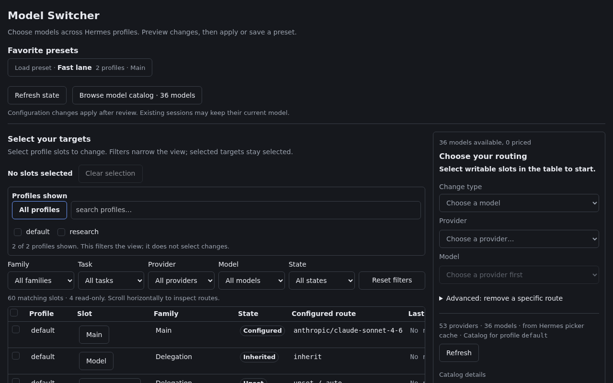

*Idle workspace in the host's dark theme: the profile filter, the routing matrix
and the change editor before any target is selected.*

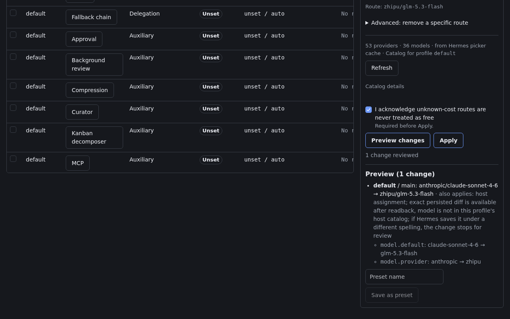

*Preview before Apply: the exact before → after route for `default/main` plus the
persisted config diff, with the unknown-cost acknowledgement in place.*

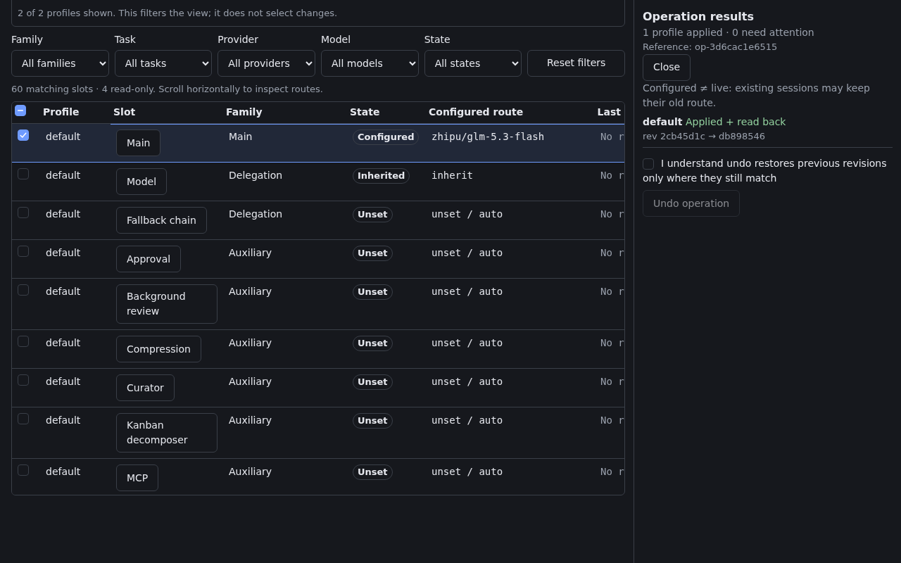

*After Apply: per-profile `Applied + read back`, the operation reference, the
revision transition, and the guarded Undo control.*

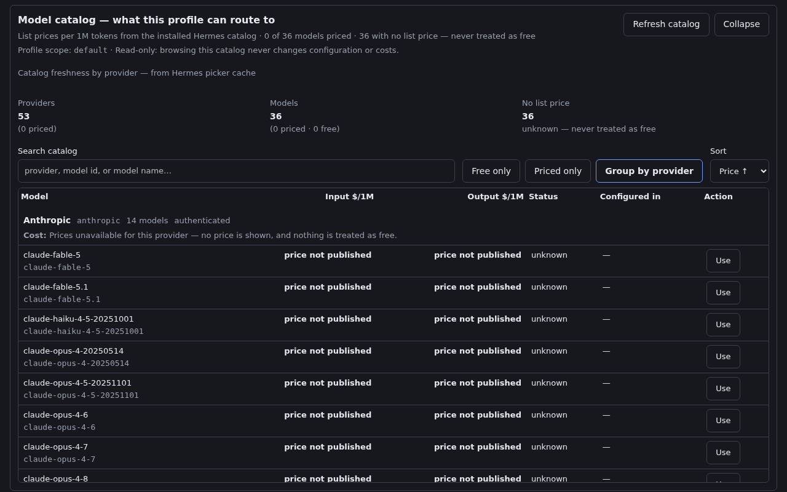

*The bird's-eye catalog, grouped by provider, with input/output price columns and a
status per row. This offline lab host publishes no pricing fields, so rows read
"price not published" — unknown is never treated as free. Prices, when a host
supplies them, come from the public host options payload.*

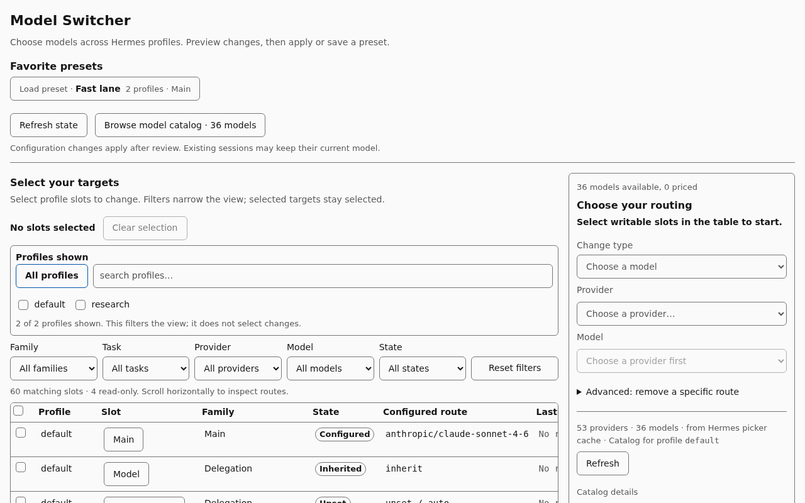

*The plugin follows the host Dashboard theme; the same idle workspace under the
light host tokens.*

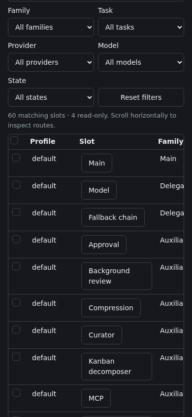

*At 390x844 the editor stacks above the matrix and the matrix scrolls horizontally
inside its own region; the page itself does not overflow.*

The images and their digests are recorded in
[`docs/images/catalog-captures.json`](docs/images/catalog-captures.json); they are
reproducible with `HMS_WRITE_CATALOG_CAPTURES=1` against the real-router harness.

<details>
<summary>Earlier captures (pre-0.3.0, kept as history)</summary>

These predate 0.3.0 and are kept unchanged for comparison. Their captions describe
the older interface.

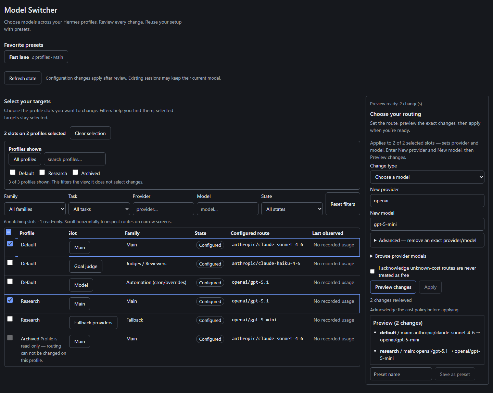

*Pre-0.3.0 capture: the compiled plugin in a Dashboard SDK fixture with synthetic
lab profiles. This screenshot demonstrates the interface; it is not evidence of live
Dashboard deployment or provider inference.*

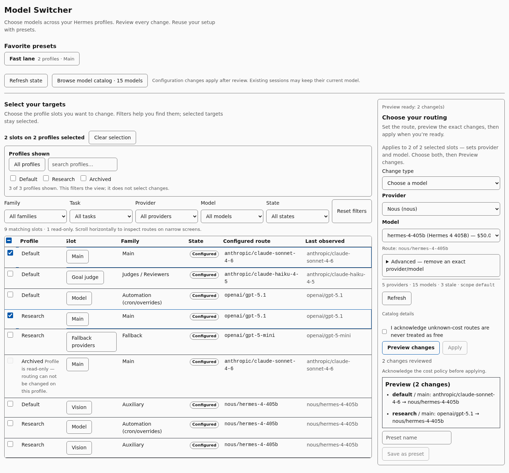

*Pre-0.3.0 capture: the plugin follows the host Dashboard's theme; the light theme
is shown here.*

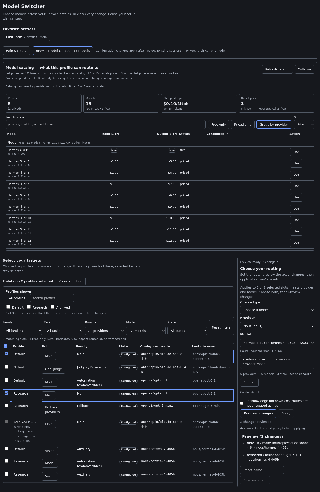

*Pre-0.3.0 capture: the provider-grouped catalog in the Dashboard SDK fixture with
synthetic lab profiles. Catalog prices come from the public host options payload,
not direct plugin cache reads, inference or recorded spend.*

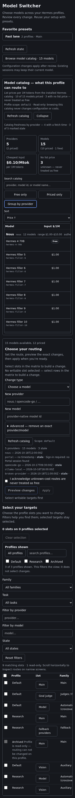

*Pre-0.3.0 capture: the same catalog on a narrow screen; a fixture render of the
compiled plugin, not a live Dashboard deployment or provider execution.*

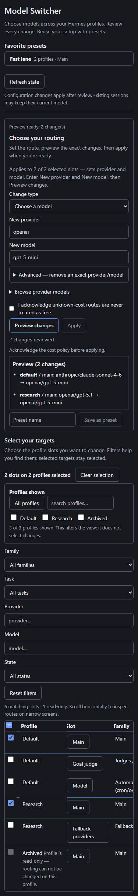

*Pre-0.3.0 capture: on a narrow screen the matrix scrolls horizontally inside its
own region.*

#### Isolated lab Dashboard captures (pre-0.3.0)

Captured at commit `02703e3` from an isolated lab Hermes Dashboard with two synthetic
profiles (default and research) and synthetic routes. They are historical evidence,
not verification of the current host-step protocol:

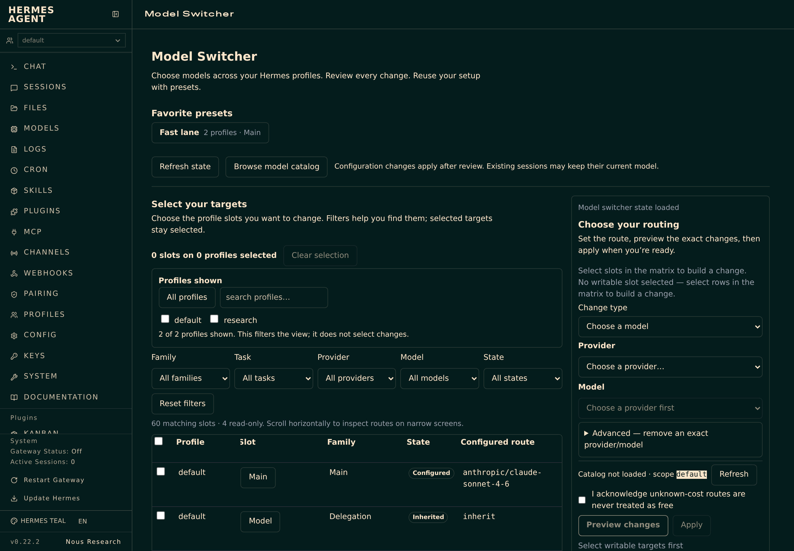

*Choose the slots you want to change; filters do not select edit targets.*

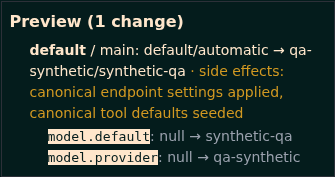

*Review provider/model intent before writing. In 0.3.0, the main slot shows semantic
intent; the exact persisted config diff appears only after readback.*

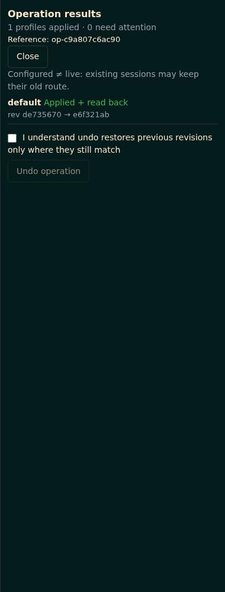

*Applied and read back. The lab's subsequent Undo restored the original configuration
bytes exactly. These captures show configuration changes, not provider inference.*

</details>

## Setup

You need a running Hermes installation with the Web Dashboard and plugin support, and
a Python version compatible with your Hermes release. This plugin declares Python
`>=3.10`; the Hermes runtime it integrates with requires Python `>=3.11`. Linux is the
verification target; macOS and native Windows are unverified.

Version **0.3.0** needs the public Dashboard `/api/model/options`,
`/api/model/auxiliary`, `/api/model/moa` and `/api/model/set` routes. The UI uses
the authenticated Dashboard SDK; no private Hermes imports or direct pricing-cache
reads are used by plugin runtime code. Missing required capabilities or host write
routes leave affected changes read-only/unavailable. Compatibility is capability-based,
not a minimum-version comparison. The tested reference is Hermes
**v0.22.2+canary.20261020T065957Z**, commit `c5a3c0f8`; see
[release readiness](docs/release-readiness.md) for evidence and remaining checks.

### From this repository

> This plugin is **not yet in the curated Hermes plugin catalog**, so the bare name
> `hermes plugins install hermes-model-switcher` does not resolve. Use the
> `owner/repo` form below until a catalog entry is merged.

```sh
# Install from the repository (pin an exact commit with --ref <40-char sha> if you want)
hermes plugins install nicolasestrem/hermes-model-switcher

# Enable it when you are ready
hermes plugins enable hermes-model-switcher

# Confirm what is installed
hermes plugins list

# Pull later changes (when the installed source tracks the repository)
hermes plugins update hermes-model-switcher
```

Run `hermes plugins install --help` for the full set of options (`--ref`,
`--enable`/`--no-enable`, `--force`, dependency-consent flags). These are the official
Hermes plugin commands; the plugin does not ship a self-updater.

**Pinned installs do not move with `update`.** Hermes refuses that command rather
than silently replacing your chosen revision. To move a pin, rerun `hermes plugins
install` with the same repository, `--force`, and `--ref` followed by the new commit's
full 40-character SHA.

The Dashboard bundle is already built and committed. If the installer reports that
build-time Node dependencies were skipped, you do not need to install them to use
these shipped assets; Node.js is needed when rebuilding the UI from source.

### From the built package

```sh
python scripts/build_package.py        # in the source repository; assembles dist-package/ (needs a built UI)
```

`dist-package/` contains the backend, the prebuilt Dashboard assets, and the
documentation, and can be pointed at a Hermes plugin directory. The builder refuses
an existing destination unless you pass `--replace`.

### Manual

Clone or copy this repository into your Hermes plugins directory as
`hermes-model-switcher`, keeping the root `plugin.yaml` and `__init__.py` together,
then enable **hermes-model-switcher** in Dashboard plugin settings and reload the
Dashboard. The repository ships the built Dashboard assets, so Node.js is needed only
when you rebuild the UI yourself.

## Make your first switch

1. **Select your targets.** Narrow the matrix with the **Profiles shown** selector
   and the **Family**, **Task**, **Provider**, **Model**, and **State** filters, then
   select the slots you want to change. Filtering changes the view only; checkboxes
   choose edit targets. The selection summary includes selected slots hidden by filters.
2. **Choose your routing.** Pick a provider, then a model from its dropdown (each
   entry shows its list price), open **Browse model catalog** to compare options, or
   choose **Other** to enter an exact provider/model pair for custom routes. Model IDs belong to their provider,
   so keep the pair together.
3. **Preview changes.** Review the affected profiles and proposed routing. Main-slot
   preview shows provider/model intent, not an exact future config diff. Resolve blocked
   entries and acknowledge unknown-cost routes when required. Changing the selection
   or routing requires a fresh preview.
4. **Apply and inspect.** Main and compatible auxiliary assignments run through the
   host write route. If Hermes requests expensive-model confirmation, approve or cancel
   its separate dialog; plugin billing approval does not bypass it. Check each profile's
   readback and exact persisted diff, then save the setup as a preset for next time.

Favorites open a preset preview before application. **Refresh state** reloads external
edits. Advanced controls cover inherited/default routing, ordered fallback sequences,
and exact-model removal; see [advanced routing](docs/technical-reference.md).

## FAQ

- **Does switching a model here start using it right away?** No. Changes update saved
  configuration; an already-running session keeps its previous routing until a new
  session starts. Configured routing is **not** proof of inference or of recorded
  usage.
- **Does it manage credentials?** It does not copy credentials between profiles or
  modify authentication stores. Presence checks use public profile-scoped secret helpers
  and authenticated host options; it never reads another profile's environment file
  directly. Missing credential evidence blocks the change. Recovery snapshots do copy
  complete pre-change configs, which can include embedded credentials; keep them private.
- **What if the model list looks stale or a provider is missing?** Model catalog
  refresh can contact provider services; a catalog result is a listing, not an
  inference test. Missing providers usually mean a missing credential on that profile.
- **Where do the catalog prices come from?** List prices per 1M tokens come only from
  `GET /api/model/options` pricing fields. The plugin does not open pricing registries
  or provider caches. Host prices can lag behind provider pages; missing or pending
  prices stay unknown, never free or `$0.00`. They are not inference or recorded spend.
- **Someone edited a config while I was reviewing — what happens?** Each operation
  validates profiles and revisions, but the host write route has no expected-revision
  check. Readback detects foreign edits and ends in `recovery_required`, not silent
  success or blind rollback. It cannot prove every possible race was observable. Avoid
  concurrent CLI/editor edits during Apply or Undo and use **Refresh state** afterwards.
- **Can I undo anything?** Undo is explicit, per-operation, and revision-guarded: it
  refuses to overwrite conflicting external edits. Disabling or uninstalling the plugin
  does **not** reverse changes already applied.
- **Where does recovery data live?** Only under `<hermes home>/state/hermes-model-switcher/`,
  with a private SQLite journal (`0600` in a `0700` directory). If that location is
  inside the plugin tree or a Git worktree, the plugin is read-only; no alternate
  location is chosen. The journal keeps a copy of each complete pre-change config,
  including any sensitive fields, not just the model selection.
- **What if my saved presets get corrupted?** The original preset store is quarantined
  (kept, not deleted) and valid entries are salvaged with a visible `presetsCorrupt`
  warning, so a damaged file is not silently swallowed and is not silently overwritten.
- **Does it work on a remote / hosted-isolation Dashboard?** Writes require an
  in-process Dashboard. Hosted isolation stays read-only; the plugin does not change
  that setting.
- **Why are some slots read-only?** Unknown model-like keys and unsupported plugin
  selectors remain coverage gaps and never receive write access.

## Limitations

- **Configured ≠ live.** Applying a change writes configuration. It is not evidence
  that a provider accepted it, that inference happened, or that a running session
  adopted it.
- **Not a single global transaction.** Multi-profile application uses a journal and
  compensation; it is not one atomic transaction across all files.
- **Explicit selection only.** Only supported, explicitly selected slots are writable;
  unknown or unsupported slots remain coverage gaps.
- **Prerequisite: connected credentials.** A missing connection blocks the change.
- **Prices are informational.** Catalog list prices can be stale or absent; they are
  not spend estimates, not cost approvals, and unknown cost is never treated as free.
- **Scale.** Large profile sets increase first-request (cold discovery) time. No
  performance measurement from the pre-refactor candidate is carried forward as
  0.3.0 acceptance. See
  [release readiness](docs/release-readiness.md) and
  [backlog](docs/backlog.md).
- **Platform scope.** Linux is the verification target; macOS and native Windows are
  unverified. Earlier green results do not establish final 0.3.0 compatibility.
- **Host capabilities required.** Missing public config, home or secret capabilities make
  the plugin read-only; missing host payloads show notices and unknown data. Main and
  compatible auxiliary writes need `/api/model/set`; other slots use public config
  load/save under the target home. No private-core compatibility shim is used.

## Privacy

The plugin does not copy credentials between profiles or rewrite authentication stores,
memories, skills, or transcripts. It uses the Dashboard's authenticated transport.
Before writing, it copies each complete pre-change config into the private undo
journal described above. Those snapshots can contain sensitive data even if only
the model was changed; never publish journals, sidecars or backups. Public operation
responses expose status, outcomes and only the current host call's allowlisted
fields/token, without raw configurations, snapshots, store paths or exception strings. Read the
[privacy audit](docs/privacy-audit.md) for scope and limits.

## Recovery

**There is no fleet-wide transaction and no always-undo promise.** Applying across
several profiles is a journalled sequence, not one atomic transaction. When a step
fails, the engine compensates in reverse order only while each profile's revision still
matches; a conflict stops compensation and the operation reports `recovery_required`. A
compensated, partial, or `recovery_required` outcome is reported as `ok=false` with a
fixed failure category and the operation's final state — a success is never claimed for
a fleet that did not fully apply.

Main and compatible auxiliary steps pause at `awaiting_host` while the UI calls
`POST /api/model/set` through the Dashboard SDK and returns a one-time-token result.
The backend verifies the actual config before committing; an HTTP success alone is
not enough. Abandoned host steps are reconciled during recovery/restart. The host
route cannot perform an expected-revision check, so foreign changes detected at
readback require recovery rather than blind restoration.

**Undo is explicit and per-operation.** It refuses to overwrite conflicting external
edits. After a crash, recovery reconciles recorded intent with the actual files. Keep
recovery data until any outstanding operation is resolved; disabling or uninstalling the
plugin does not reverse changes already applied.

## Develop and contribute

See
[CONTRIBUTING.md](CONTRIBUTING.md)
for dependency setup, the portable vs real-runtime test split, and the CI workflow. In
short:

```sh
python -m pip install -e '.[test]'
npm ci && npm run build
python -m pytest tests/
npm test
python scripts/privacy_guard.py
```

Read the [design contract](DESIGN.md), [usability notes](docs/usability-polish.md),
[technical reference](docs/technical-reference.md),
[verification scope](docs/verification.md), and
[release findings](docs/release-readiness.md). Changes should preserve preview, apply,
readback, and guarded Undo.

## License

[MIT](LICENSE). This is a community project and does not claim official Hermes
endorsement or catalog listing.
